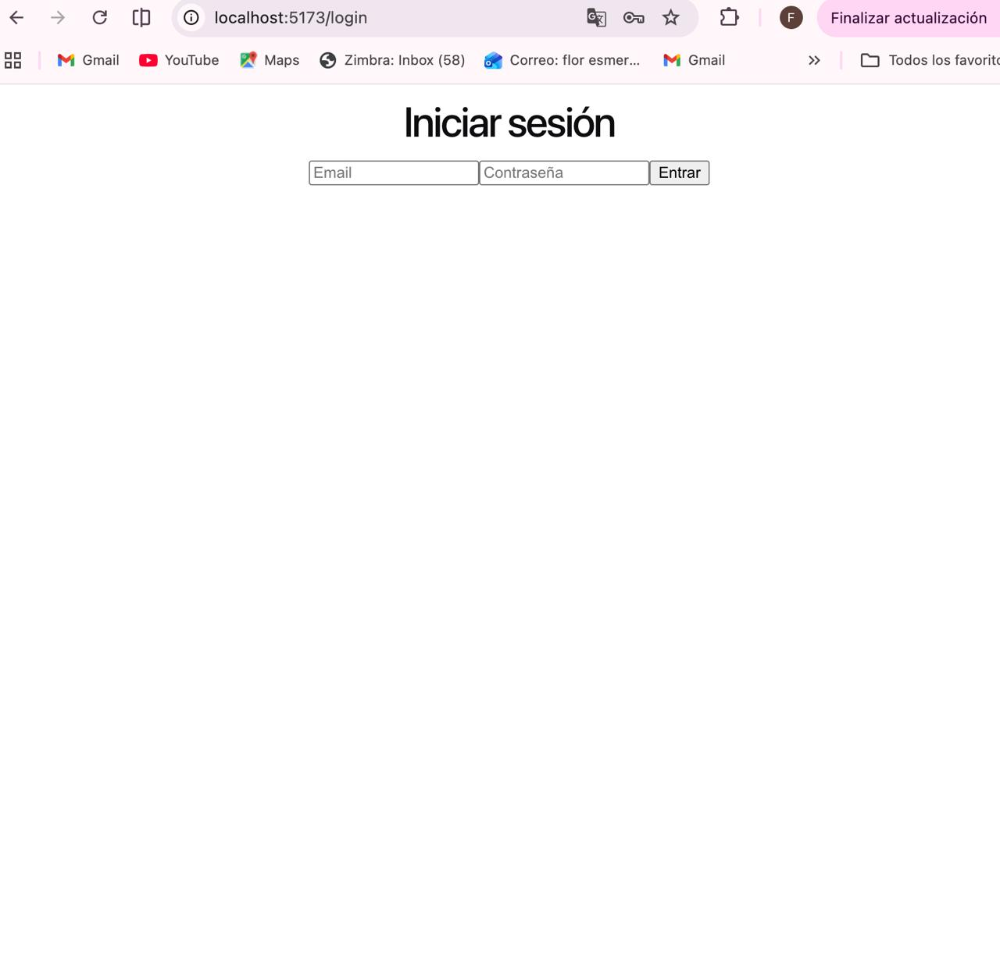
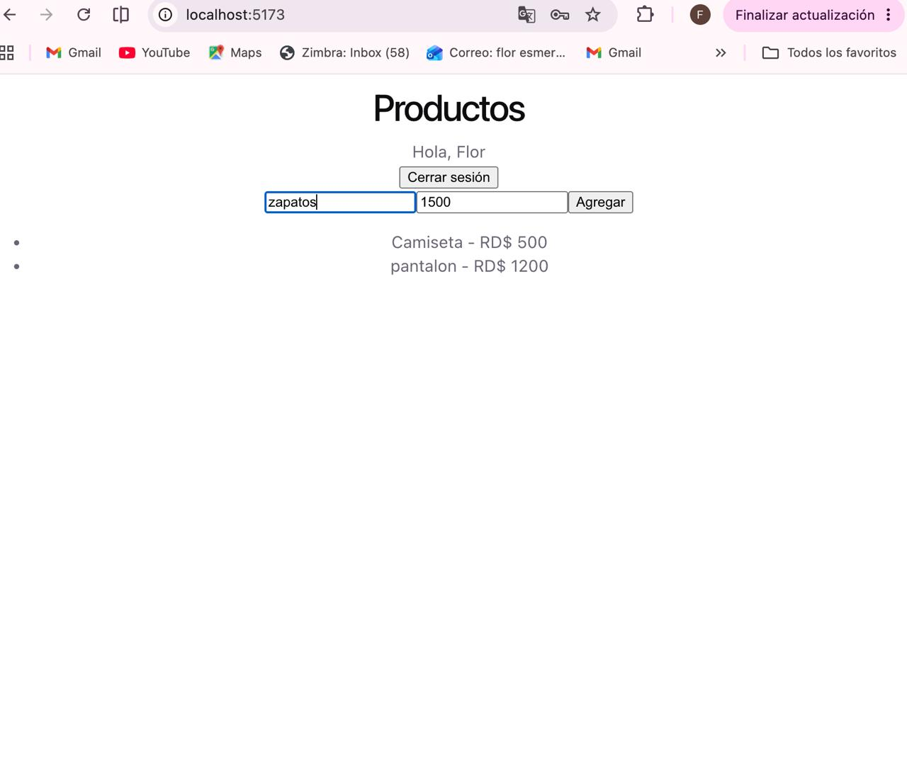
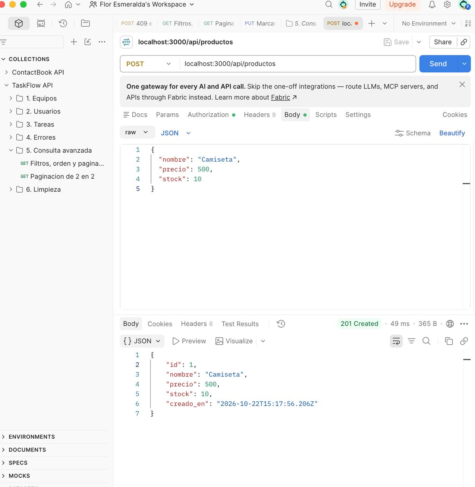
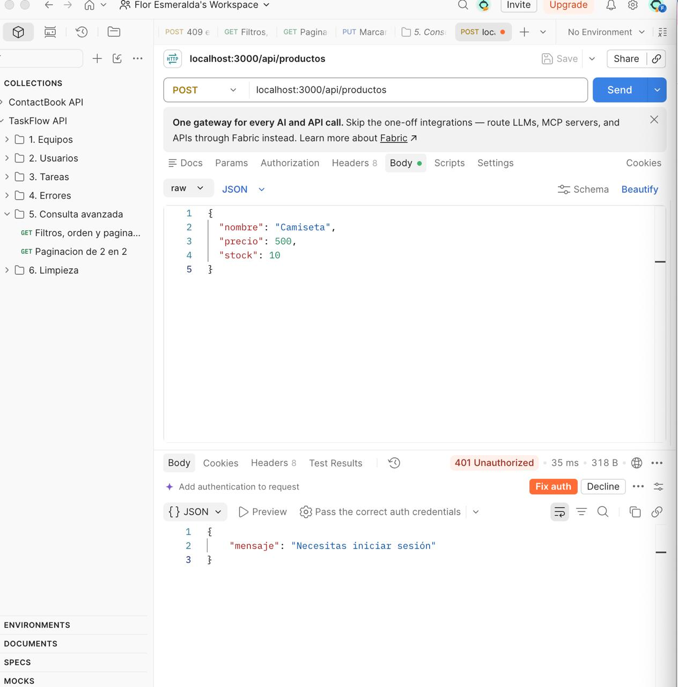

# tienda-fullstack

Proyecto de Talendig. API de una tienda con Node y Express, y frontend en React.

Productos y usuarios en SQL Server, reseñas en MongoDB.

## Tecnologias

Node.js, Express, SQL Server (mssql), MongoDB (mongoose), bcryptjs, jsonwebtoken, React con Vite, TanStack Query y React Router.

## Como correrlo

Bases de datos en Docker:

```
docker start sqlserver mongo
```

Ejecutar el script `api/tienda.sql` para crear la base y las tablas.

Copiar `api/.env.example` a `api/.env` y poner los datos.

API:

```
cd api
npm install
npm run dev
```

Frontend:

```
cd frontend
npm install
npm run dev
```

## Rutas

- POST /api/auth/registro
- POST /api/auth/login
- GET /api/productos
- GET /api/productos/:id
- POST, PUT y DELETE /api/productos (con token)
- GET y POST /api/resenas

## Arquitectura

La API esta separada en routes, controllers, db, models y middlewares. El modulo hexagonal lo agrego en la proxima entrega.

## Capturas




